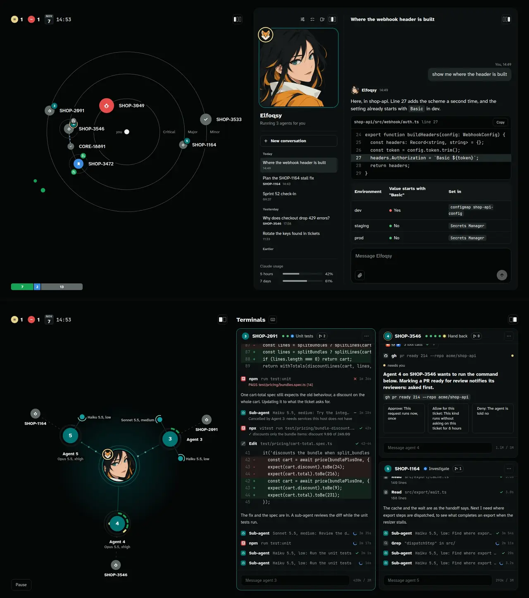
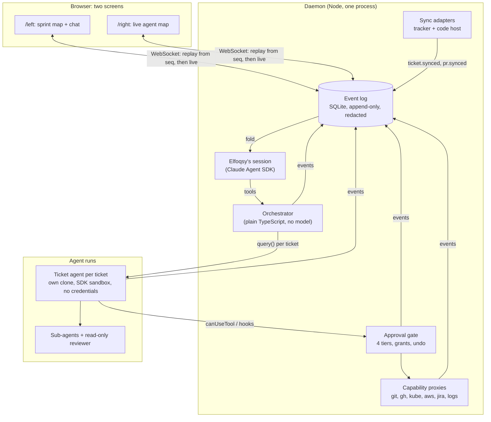

# Elfoqsy

[](https://github.com/lilsadfoqs/elfoqsy/actions/workflows/ci.yml)
[](LICENSE)

**A local-first orchestrator that runs one coding agent per ticket, with an approval gate and full replay.**

Elfoqsy reads your sprint, starts a Claude coding agent for each ticket in its own clone, lets it split work into sub-agents, and stops to ask you whenever a decision or a risky action needs a human. Everything that happens is an event in an append-only log, and both screens are pure folds over that log. Close the browser, restart the daemon, or open last week's log: the screens rebuild exactly.



| Left screen | Right screen |
| --- | --- |
| The sprint as an orbit map, and a chat with Elfoqsy, the workspace's AI persona. | A live map of every agent, its sub-agents, and the approvals it is waiting on. |

## Try it in one command

You need Node 20.19 or newer and pnpm 8. Simulate mode replays a scripted sprint for a fictional shop, so it needs no tokens, no Jira and no GitHub.

```bash
pnpm i && pnpm dev:sim
```

Open http://127.0.0.1:5173/left and http://127.0.0.1:5173/right, ideally in two windows side by side.

To run it against your own Jira and GitHub, copy `.env.example` to `.env`, log in with `gh auth login` and `claude auth login`, and run `pnpm dev`. The full guide is in [docs/USING.md](docs/USING.md).

## How it works



- **One contract.** Every event type lives in [`contracts/events.ts`](contracts/events.ts). The daemon validates each payload with Zod before it is written, and the web app imports the same types.
- **Screens are folds.** `packages/state` holds `fold(state, event)`. The daemon and the browser run the same function, so what Elfoqsy reasons about is exactly what you see.
- **The orchestrator never calls a model.** Starting runs, routing approvals, tiering actions and undoing them are plain, tested TypeScript. Models only work tickets and talk.
- **Agents hold no credentials.** Every remote action goes through a proxy that classifies it into one of four tiers, runs it with your credentials only if the tier allows, and records the earlier state first so it can be undone.

The details are in [docs/architecture.md](docs/architecture.md).

## The approval gate

| Tier | What happens | Examples |
| --- | --- | --- |
| 0 | Runs at once, logged | Reading tickets, PRs, CI, non-prod logs; `kubectl get` |
| 1 | Recorded, runs at once, undoable | Pushing the run branch, opening a draft PR, re-running failed CI |
| 2 | Asked first, batched, or covered by a grant | Marking a PR ready, writes on staging, reading a secret |
| 3 | Refused, always | Merging, anything on prod, force-push, `kubectl apply` |

Before a tier-2 request reaches you, Elfoqsy can answer it herself in categories you delegate. Each delegated answer cites its sources and shows up with Undo or Change.

## Design decisions and why

- **Event sourcing over a mutable database.** Agents run for minutes to hours and fail in interesting ways. An append-only log makes every run replayable, every screen reproducible, and every bug report a file you can fold again.
- **A model-free orchestrator.** Permission decisions must be deterministic and testable. Keeping models out of the control plane means the gate is covered by ordinary unit tests, about two thousand of them.
- **Tiers instead of yes/no prompts.** Asking about everything trains people to click Approve. Most actions are reads or undoable writes, so only the irreversible or sensitive ones interrupt you.
- **Record before change.** Every tier-1 or tier-2 write stores what it is about to replace, so Undo replays an inverse through the same gate instead of trusting the agent to clean up.
- **Per-run clones and the SDK sandbox instead of containers.** Fast to start and enough isolation for one trusted user on one machine. The trade-off is written down in the architecture doc.
- **Polling instead of webhooks.** A local daemon cannot receive webhooks without a tunnel, and a 60-second poll is fine for one person's sprint. Sync is all-or-nothing, so a flaky page never removes tickets from the screen.
- **Adapters at the edges.** The sync logic only knows two small interfaces, so Linear or GitLab is one class, not a fork.

## Add your own tracker or code host

```ts
import type { TrackerAdapter } from './adapters/types';

export class LinearTracker implements TrackerAdapter {
  readonly id = 'linear';
  constructor(readonly projects: readonly string[], private readonly api: LinearClient) {}
  async currentTickets() {
    const issues = await this.api.currentCycleIssues(this.projects);
    return issues.map(toTicket); // map onto the contract's Ticket
  }
}
```

Pass it to the poller in `apps/daemon/src/main.ts`; the screens need no change. The interfaces are in [`apps/daemon/src/adapters/types.ts`](apps/daemon/src/adapters/types.ts), with Jira and GitHub as the reference implementations. The full ticket view and ticket edits are still Jira-specific; moving them behind the tracker interface is the next step.

## Repository layout

| Path | What it holds |
| --- | --- |
| `contracts/` | The event contract and Elfoqsy's tool list |
| `packages/contracts` | Zod schemas and the WebSocket protocol |
| `packages/state` | The fold and derived views, shared by daemon and web |
| `apps/daemon` | Event log, server, Elfoqsy, orchestrator, gate, proxies, adapters, simulator |
| `apps/web` | The two screens (React, Vite) |
| `prompts/` | Elfoqsy's identity and system prompts |
| `design/` | Design tokens: every colour, size and font |
| `mock/`, `config/` | Simulate-mode data and the demo company's configuration |

## Development

```bash
pnpm --filter @elfoqsy/daemon run typecheck
pnpm --filter @elfoqsy/daemon run test
pnpm --filter @elfoqsy/web run test
```

CI runs the typecheck and tests of every package separately, so one package's failure cannot hide behind another's success. The Claude Agent SDK is replaced by an in-process fake in tests, so the suite makes no model calls.

## How this was built

I designed Elfoqsy and wrote its specifications: the event contract, the tier policy, the screen designs and the acceptance criteria. Most of the code was written by Claude Code agents working from those specifications, one milestone at a time, and every change was reviewed and tested before it landed. The project is as much about directing coding agents safely as it is a tool for doing so.

## License

MIT. Brand icons in `assets/tool-icons` belong to their owners; their sources and licences are listed in [`assets/tool-icons/SOURCES.md`](assets/tool-icons/SOURCES.md).
